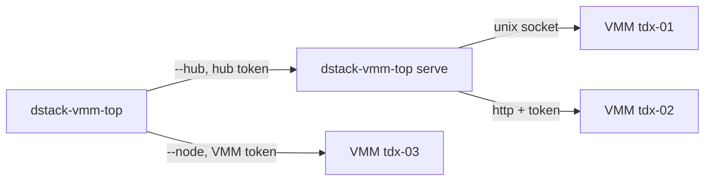

# Watching VMM nodes from a terminal

`dstack-vmm-top` is a live terminal dashboard for one or many `dstack-vmm` nodes. It shows every CVM's state, boot progress and resource allocation, each node's capacity, and a running journal of what changed. From the same screen you can tail a VM's serial, stdout and stderr logs and start, shut down, restart or stop it.

It is only ever a client. It reads each node's existing VMM API, or reads a hub that polls many nodes on its behalf, so watching a whole fleet needs no change to the VMMs.

## Quick start

Run it on a host with a VMM and it finds the local instances on its own, from the registration files every `dstack-vmm` writes under `$XDG_RUNTIME_DIR/dstack-vmm/`:

```bash
cargo build --release -p dstack-vmm-top
./target/release/dstack-vmm-top
```

Watch other nodes by naming them. `--node` takes a VMM address, `unix:/path/vmm.sock` or `http(s)://host:port`, optionally prefixed with a display name:

```bash
export DSTACK_VMM_TOKEN=...          # only if the VMMs have [auth] enabled
dstack-vmm-top -n tdx-01=http://10.0.0.11:9080 -n tdx-02=http://10.0.0.12:9080
```

Piped, or with `--once`, it prints one plain-text snapshot and exits. `--json` prints the same data as JSON:

```text
$ dstack-vmm-top -n tdx-01=http://10.0.0.11:9080 -n tdx-04=http://10.0.0.14:9080 --once
NODE                 STATUS       VMS      VCPU         MEM   GPU    RTT  ENDPOINT
tdx-01               online       4/6     28/96   112G/384G   1/4   15ms  http://10.0.0.11:9080
tdx-04               down           -         -           -     -      -  http://10.0.0.14:9080
  error: error sending request for url (http://10.0.0.14:9080/prpc/Status?json)

VM                           NODE             STATUS          UPTIME  VCPU    MEM   DISK  ID        IMAGE
postgres-primary             tdx-01           exited               -     8    32G    40G  b8b6d8fe  dstack-0.5.4
api-gateway                  tdx-01           booting             0s     8    32G    20G  1e2feb89  dstack-0.5.4
kms-auth                     tdx-01           running          3d17h     8    32G   200G  1622bd79  dstack-0.5.4
```

## Watching a fleet through a hub

A VMM usually listens on a unix socket only, each node has its own token, and every operator polling every node multiplies the load. A hub solves all three. Run `dstack-vmm-top serve` next to the VMMs: it reaches their sockets, holds their tokens, polls each node once, and serves the result to any number of terminals under one URL and one token of its own.



On the hub host, with nothing configured, `serve` watches the local VMMs:

```bash
export DSTACK_VMM_TOP_TOKEN=$(openssl rand -hex 32)
dstack-vmm-top serve --listen 0.0.0.0:9970 --name dc-east
```

Then from anywhere, using the same token:

```bash
export DSTACK_VMM_TOP_TOKEN=...
dstack-vmm-top --hub https://vmm-hub.example:9970
```

`--hub` and `--node` mix freely, so one terminal can watch several hubs plus a few nodes polled directly. Nodes seen through a hub are labeled `via <hub>`.

The hub is read-only by construction. It serves snapshots and log tails and has no route that changes a VM, so its token lets someone watch but never stop anything. Start, shutdown, restart and stop are offered only for nodes polled directly with their own VMM token. The hub never sends VM secrets: no encrypted env, user config or compose file is in a snapshot. It refuses to listen on a non-loopback address without a token unless given `--insecure`, and it serves plain HTTP, so put it behind a TLS-terminating proxy, or an SSH tunnel, when it crosses an untrusted network.

| Route | Answers |
|---|---|
| `GET /healthz` | `ok`, no token needed |
| `GET /api/v1/nodes` | every node's latest snapshot as JSON |
| `GET /api/v1/logs?node=&id=&ch=serial\|stdout\|stderr&lines=` | the last lines of one VM's log, for VMs the node listed |

## Config file

Long node lists belong in `~/.config/dstack/vmm-top.toml` (or pass `-c FILE`). Both the TUI and the hub read it:

```toml
interval = "2s"
read_only = false
# Also watch this host's VMMs. Defaults to on only when nothing else is listed.
# discover = true

[[node]]
name = "tdx-01"
url = "http://10.0.0.11:9080"
token_env = "TDX01_VMM_TOKEN"      # or token = "..."

[[hub]]
name = "dc-east"
url = "https://vmm-hub.east.example:9970"
token_env = "DC_EAST_HUB_TOKEN"

# Used by `dstack-vmm-top serve`.
[serve]
name = "dc-west"
listen = "0.0.0.0:9970"
token_env = "DSTACK_VMM_TOP_TOKEN"
```

A node without its own token gets `--token` or `DSTACK_VMM_TOKEN`, and a hub without one gets `--hub-token` or `DSTACK_VMM_TOP_TOKEN`. A VMM token is never sent to a hub.

## Reading the screen

The **Fleet** tab is a tree of nodes and their VMs. A node row rolls up its VMs: allocated vCPU and memory against the node's limits, provisioned disk, attached GPUs, and the round-trip time of the last poll. The header totals the same across all nodes, and on wide terminals a board lists every node's load side by side. **VMs** is one flat, sortable list across all nodes. **Events** is the journal: VM state changes (`running → exited`), nodes going down and coming back, actions taken from this terminal, and the guest's own boot events.

A VM's status folds the VMM's runtime status together with what the guest reported, the way the web console does. `booting` shows the current boot step (`requesting app keys`), `failed` shows the boot error inline, and anything in transition spins. Allocation counts only VMs holding host resources, so an exited or stopped VM does not use up a node's vCPU.

When a node stops answering, its last good data stays on screen, dimmed and marked `?`, with how long ago it was fresh. A dead node never makes its VMs vanish from view.

## Keys

| Key | Action |
|---|---|
| `1` `2` `3`, `tab` | Fleet · VMs · Events |
| `↑` `↓`, `j` `k`, `pgup` `pgdn`, `g` `G` | move |
| `←` `→`, `h` `l`, `z` | fold or unfold a node, all nodes |
| `enter` | full-screen detail: Info, Serial, Stdout, Stderr, Events |
| `v` | preview pane under the list |
| `x` | act on the VM: `u` start, `d` shutdown, `r` restart (force stop, then start), `k` force stop, then `y` to confirm |
| `/` | filter by name, id, app id, image, status or node |
| `a` | scope: all · live (holding resources) · attention (failed, exited, in transition, unreachable) |
| `s` `S`, `I` | sort by status, name, node, uptime, vcpu or memory; invert |
| `r`, `p`, `+` `-` | refresh now, pause, change the poll interval |
| `?`, `q` | help, quit |

In the detail view, logs follow the tail until you scroll up, `f` toggles following, and `←` `→` pan long lines. The mouse works too: click to select, click a selected node to fold it, double-click to open, and scroll with the wheel.
